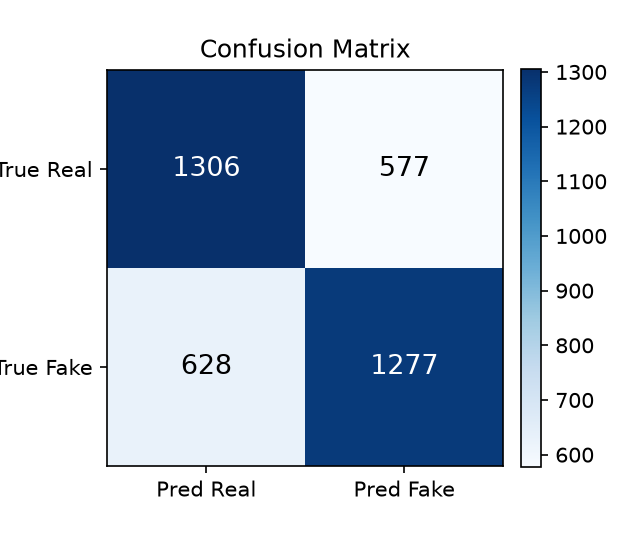
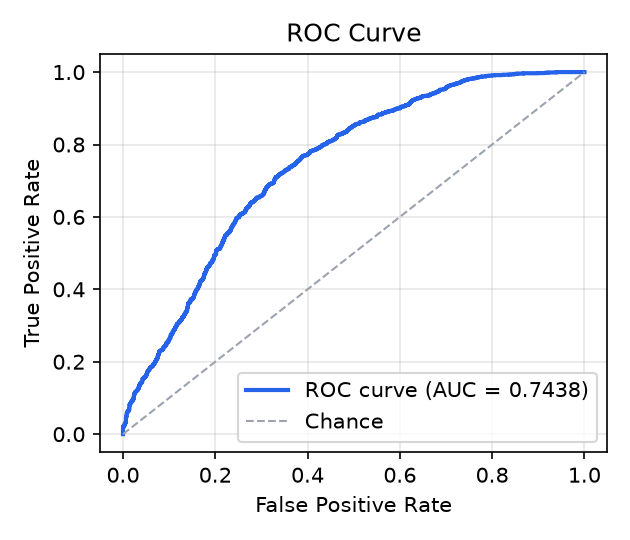

# Deepfake Detection — CNN

A CNN-based image authenticity checker: upload a face image and an
EfficientNet-B0 convolutional network, fine-tuned on the **Celeb-DF v2**
deepfake benchmark, estimates whether it is a genuine photograph or an
AI-generated / manipulated (deepfake) image — with a confidence score and
the model's **measured** test performance displayed next to it.

Every performance number in this repository is a real measured result,
produced by `evaluate.py` on a held-out test set the model never trained
on, and stored in `results/`. There are no placeholder or hardcoded
metrics anywhere in the code or UI.

**Scope:** the detector is trained on **face-swap** manipulations only.
It is not trained on face morphs, fully AI-generated portraits, or
AI-edited photos (e.g. images regenerated by a ChatGPT/Gemini editor),
and will generally call those "real" — a "Real" verdict means *no
face-swap detected*, not *certified genuine*. See *Limitations*.

   

🌐 **Live demo:** [deepfake-detection-cnn.onrender.com](https://deepfake-detection-cnn.onrender.com) — try it in your browser (hosted on Render's free tier, so the first load after idle may take ~50 seconds to wake).

## Features

- **Single, explainable CNN** — EfficientNet-B0 (alternative backbones:
  EfficientNet-V2-S/M, ResNet-50), not a black-box ensemble.
- **Web UI** — drag & drop / browse / paste an image, get a Real/Fake
  verdict with an animated confidence meter, separate Real-vs-Fake
  probability bars, and a plain-language interpretation (borderline
  scores are honestly labelled *inconclusive*).
- **Measured metrics in the UI** — accuracy, precision, recall, F1 and
  ROC-AUC plus the confusion-matrix and ROC-curve plots, all read from
  `results/metrics.json` at runtime (nothing is typed into the page).
- **Honest evaluation pipeline** — video-level train/val/test splits (no
  frame leakage), sklearn metrics at the standard 0.5 threshold, and a
  baseline-vs-fine-tuned comparison on the *same* test crops.
- **Two ways to predict** — the FastAPI web app, or a command-line
  inference script.
- **Reproducible data prep** — a scripted pipeline (frame sampling →
  face detection → crops → manifest) turns the raw Celeb-DF videos into
  the exact image dataset used, with a full audit manifest.

## Results

Evaluated on the **official Celeb-DF test set** (128-video balanced
subset: 64 real + 64 fake videos, face crops the model never saw in
training or validation). Decision threshold 0.5.

Frame-level results (3,788 test crops: 1,883 real / 1,905 fake):

| Model | Accuracy | Precision | Recall | F1-score | ROC-AUC |
|---|---|---|---|---|---|
| Original CNN checkpoint (baseline, before this rebuild) | 47.78% | 0.237 | 0.017 | 0.032 | 0.437 |
| **Fine-tuned EfficientNet-B0 — round 1 (shipped model)** | **68.19%** | 0.689 | 0.670 | 0.679 | 0.744 |
| Fine-tuned EfficientNet-B0 — round 2 (larger retrain, not shipped) | 66.97% | 0.888 | 0.393 | 0.545 | 0.867 |

Shipped model, confusion matrix (frame level): TN = 1,306, FP = 577,
FN = 628, TP = 1,277. The baseline catches only 33 of 1,905 fake crops —
it predicts "real" for nearly everything.

Video-level results (the 128 test videos scored by averaging their crop
probabilities — the protocol the Celeb-DF benchmark itself uses):

| Model | Accuracy | F1-score | ROC-AUC |
|---|---|---|---|
| Baseline | 49.22% | 0.000 | 0.422 |
| **Round 1 (shipped)** | **72.66%** | 0.729 | 0.772 |
| Round 2 | 65.62% | 0.511 | 0.896 |

Confusion matrix and ROC curve for the shipped model:

| | |
|---|---|
|  |  |

Validation performance during training (video-level validation split,
used only for checkpoint selection — *not* the reported result):
the shipped model's best epoch reached **99.24% accuracy / 0.9999
ROC-AUC** on 1,585 validation crops; round 2's best reached 97.84% /
0.9970 on its harder 5,460-crop validation split.

### What round 2 showed (read this before quoting the numbers)

Round 2 retrained on 3.5× more data — crucially adding Celeb-real
footage, the same source as the test set's real videos. It **improved
ranking quality a lot** (test ROC-AUC 0.744 → 0.867 frame-level,
0.772 → 0.896 video-level) but **shifted the model's calibration**:
it became conservative, calling far fewer frames fake (false positives
577 → 94, but fake recall 0.67 → 0.39), so at the standard 0.5
threshold its accuracy and F1 are slightly *below* round 1. A threshold
study (choosing each model's threshold on its own validation split —
0.54 for round 1, 0.59 for round 2 — then applying it to the test set)
confirmed the gap is not a threshold artifact: round 1 still leads
(68.03% vs 65.13% frame-level). The validation-optimal threshold does
not transfer because validation and test come from different footage —
the same domain shift that keeps validation accuracy (~98–99%) far
above test accuracy (~68%). **Round 1 therefore ships**; round 2's full
metrics are kept in `results/metrics_r2.json` for comparison. Celeb-DF
is a deliberately hard benchmark — published detectors report similar
ranges — and the honest lesson of this project is that *more data
improved the model's ranking (AUC) without automatically improving
accuracy at a fixed threshold*.

## Tech stack

| Layer | Technology |
|---|---|
| Language | Python 3.11+ |
| Deep learning | PyTorch + torchvision (EfficientNet-B0) |
| Data pipeline | OpenCV (frame sampling, Haar face detection), Albumentations (augmentation) |
| Evaluation | scikit-learn (metrics + plots), matplotlib |
| Web app | FastAPI + Uvicorn, vanilla HTML/CSS/JS frontend |
| Packaging | Docker (CPU image) + docker-compose |

## Model architecture

- **Backbone:** EfficientNet-B0, initialized with ImageNet weights
  (compound-scaled MBConv blocks — strong accuracy at ~5.3M parameters,
  fast enough for CPU inference).
- **Head:** the original classifier layer is replaced with
  `Dropout(p=0.4) → Linear(1280, 1)`, producing a single logit; a sigmoid
  gives the fake-probability. `> 0.5` → **Fake**, otherwise **Real**.
- **Loss:** Focal Loss (α = 0.25, γ = 2.0) with label smoothing 0.05 —
  focuses learning on hard examples and tolerates the mild class
  imbalance in the crop counts.
- **Why one CNN?** A single architecture is fast to run, straightforward
  to explain in an interview, and can be evaluated honestly end-to-end —
  unlike an ensemble whose numbers are hard to attribute.

## Dataset

**Celeb-DF v2** (Li et al., *Celeb-DF: A Large-scale Challenging Dataset
for DeepFake Forensics*, CVPR 2020) — real celebrity/YouTube face videos
and high-quality face-swap deepfakes made from them. Obtained from the
Kaggle competition page `kaggle.com/c/deepfake-detection` (a repack of
Celeb-DF v2; free Kaggle account + rules acceptance required). The
dataset is **not** redistributed in this repository.

Subset used (compute-bounded, selected deterministically):

| Split | Source | Videos | Face crops |
|---|---|---|---|
| Train (round 1, shipped) | 200 fake (`Celeb-Youtube-fake`) + 150 real (`YouTube-real`), 85% by video | 297 | 8,781 (3,808 real / 4,973 fake) |
| Validation (round 1) | same pool, 15% by video | 53 | 1,585 (566 real / 1,019 fake) |
| Train (round 2) | 600 fake + 632 real (150 `YouTube-real` + all 482 `Celeb-real`), 85% by video | 1,046 | 30,974 (15,702 real / 15,272 fake) |
| Validation (round 2) | same pool, 15% by video | 185 | 5,460 (2,761 real / 2,699 fake) |
| Test | official Celeb-DF test set, balanced subset | 128 (64 real / 64 fake) | 3,788 (1,883 real / 1,905 fake) |

Full provenance, the test-label protocol, and the datasets that were
considered and rejected (FaceForensics++, CIFAKE, 140k faces, …) are in
[docs/DATASETS.md](docs/DATASETS.md).

### Preprocessing & augmentation

- **Video → images** (`scripts/prepare_faceforensics.py`): up to 30
  evenly spaced frames per video; largest face per frame detected with
  the OpenCV Haar cascade (MTCNN supported as an alternative), cropped
  with a 35% margin, resized to 256×256 JPEG. Every crop is logged in
  `manifest.csv`.
- **Model input:** resize to 224×224, ImageNet normalization
  (mean `[0.485, 0.456, 0.406]`, std `[0.229, 0.224, 0.225]`).
- **Training augmentation** (Albumentations): horizontal flip, ±15°
  rotation, brightness/contrast jitter, JPEG recompression
  (quality 60–100), Gaussian + ISO noise, Gaussian blur, and coarse
  dropout — chosen to simulate the degradations face images undergo when
  shared online, so the model learns artifacts, not compression levels.
- **Leakage guard:** splits are assigned **per video, never per frame** —
  no frame of a test/validation video ever appears in training.

## Training procedure

Transfer learning: the ImageNet-pretrained EfficientNet-B0 was
fine-tuned end-to-end on the Celeb-DF face crops in two runs on CPU
(the second run continues the first run's best checkpoint at a lower
learning rate — a standard fine-tune schedule):

| Setting | Run 1 | Run 2 (continuation) |
|---|---|---|
| Initialization | ImageNet weights | Run 1 best checkpoint |
| Epochs | 1 completed (run stopped by the VM's memory limit during epoch 2) | 3 (best at epoch 2) |
| Batch size | 32 | 16 |
| Learning rate | 1e-4 | 5e-5 |
| Optimizer | AdamW (weight decay 1e-4) | AdamW (weight decay 1e-4) |
| LR schedule | ReduceLROnPlateau on val AUC (patience 2, factor 0.5) | same |
| Loss | Focal Loss α=0.25, γ=2.0, label smoothing 0.05 | same |
| Seed | 42 | 42 |
| Checkpoint selection | best validation ROC-AUC (video-level val split) | same |

Final model: `checkpoints/best_cnn_efficientnet_b0.pth`
(val accuracy 99.24%, val ROC-AUC 0.9999). The training log is kept at
`data/train_finetune.log` / `data/train_continue.log` in the working
copy (data folder is not committed).

**Round 2 (larger retrain).** Same recipe, initialized from the round-1
best checkpoint, 3 epochs planned at lr 5e-5 on the expanded pool above
(36,434 crops). The run was interrupted twice by environment restarts:
epoch 1 completed (val 96.94% / AUC 0.9944) and, after resuming from
that checkpoint, epoch 2 completed (val **97.84% / AUC 0.9970**); the
third epoch was interrupted at ~75% and not resumed — the epoch-2
checkpoint is the round-2 candidate evaluated in Results. Per the
project rule, round 2 would have shipped only if it beat round 1 on
the identical test crops; it did not (see "What round 2 showed"), so
round 1 remains the shipped model.

## Evaluation

`evaluate.py` runs a checkpoint over a held-out folder of crops and
writes `results/<name>.json` plus confusion-matrix and ROC-curve PNGs,
using sklearn at threshold 0.5 (configurable via `--threshold`) —
accuracy, precision, recall, F1, ROC-AUC and the full confusion
matrix, with run metadata (dataset, sample counts, timestamp). It also
reports **video-level** metrics, averaging each video's crop
probabilities before deciding. The web UI's metrics panel is fed by
`results/metrics.json`, and the baseline comparison above comes from
running the same script with the *original* pre-rebuild checkpoint on
the *same* test crops.

## Installation & setup

```bash
git clone https://github.com/Harsh10172005/Deepfake-Detection-CNN.git
cd Deepfake-Detection-CNN
python -m venv .venv && source .venv/bin/activate   # Windows: .venv\Scripts\activate
pip install -r requirements.txt
```

You also need a trained checkpoint at
`checkpoints/best_cnn_efficientnet_b0.pth` (checkpoints are not
committed — train one as below, or place your own there; the app
reports a clear 503 until weights exist). The trained checkpoint for
this project is attached to the **v1.0 GitHub Release** of this repo.

**Deploying (Render):** `render.yaml` defines the service (Docker,
free plan). Because the checkpoint is not in git, the app downloads it
at startup when the `WEIGHTS_URL` environment variable is set — the
blueprint already points it at the v1.0 Release asset. The Docker
image honours the host's `$PORT`.

Or with Docker:

```bash
docker compose up --build   # serves on http://localhost:8000
```

## How to train

1. **Get the data** — download Celeb-DF as described in
   [docs/DATASETS.md](docs/DATASETS.md) and place the pool/test video
   folders somewhere local.
2. **Prepare face crops:**

```bash
python scripts/prepare_faceforensics.py --source celebdf \
  --celeb_fake_dir /path/to/Celeb-Youtube-fake \
  --celeb_real_dir /path/to/YouTube-real \
  --celeb_test_dir /path/to/test \
  --test_labels data/selection/test_labels.csv \
  --out_dir data/celebdf --detector haar --frames_per_video 30
```

3. **Fine-tune** (video-level validation via `--val_dir`):

```bash
python train.py --data_dir data/celebdf/train --val_dir data/celebdf/val \
  --model_name efficientnet_b0 --epochs 5 --batch_size 32 \
  --learning_rate 1e-4 --seed 42
```

4. **Evaluate** on the held-out test crops:

```bash
python evaluate.py --weights checkpoints/best_efficientnet_b0.pth \
  --data_dir data/celebdf/test \
  --dataset_name "Celeb-DF official test set (128-video subset)" \
  --out_name metrics
```

## How to run / predict

**Web app:**

```bash
python app.py            # http://localhost:8080
# env: MODEL_NAME, MODEL_WEIGHTS, PORT
```

Open the page, drop in a face image, and read the verdict — the metrics
panel below shows the model's measured test performance.

**Command line:**

```bash
python inference.py --weights checkpoints/best_cnn_efficientnet_b0.pth path/to/image.jpg
# -> Prediction: Fake (AI-generated / manipulated) (Confidence: 0.95, Fake Probability: 0.95)
```

**API:**

- `GET /api/health` — service + model status
- `GET /api/metrics` — contents of `results/metrics.json`
- `POST /api/predict` — multipart image upload → `{prediction, confidence, probability_fake, ...}`

## Project structure

```
Deepfake-Detection-CNN/
├── app.py                        # FastAPI web app (UI + /api/*)
├── models.py                     # CNN definitions (EfficientNet family, ResNet-50)
├── dataset.py                    # Dataset + train/val transforms
├── train.py                      # Training loop (FocalLoss, AdamW, --val_dir/--init_weights)
├── evaluate.py                   # Held-out evaluation -> results/*.json + plots
├── inference.py                  # Single-image CLI prediction
├── requirements.txt
├── Dockerfile / docker-compose.yml
├── static/                       # Web UI (index.html, style.css, script.js)
├── scripts/
│   └── prepare_faceforensics.py  # Video -> face-crop dataset builder (Celeb-DF / FF++ / DFDC modes)
├── docs/
│   └── DATASETS.md               # Dataset provenance, subset, split protocol
├── results/                      # metrics.json, baseline metrics, confusion/ROC plots
├── tests/
│   └── test_pipeline.py          # Plumbing + regression tests
└── data/                         # (git-ignored) raw videos, crops, manifests, logs
```

## Limitations & future work

- **Face-swaps only.** The detector learned one manipulation family —
  a face pasted onto another person (Celeb-DF). Face morphs, fully
  AI-generated portraits, and AI-edited photos (whole-image
  regeneration, e.g. a ChatGPT-edited picture) are outside its
  training and are generally classified "real": verified live, a
  ChatGPT-edited photo scored a fake probability of 0.11–0.16, and
  morph images were likewise missed. Catching those families needs
  training data of those manipulations, not a threshold change.
- **Image-level, face-only.** The model judges single face images. It
  does not analyze video temporal cues, audio, or non-face AI imagery,
  and tightly cropped faces work best.
- **One benchmark.** Trained and tested on Celeb-DF v2 only;
  cross-dataset generalization (e.g. FaceForensics++, DFDC) is the
  natural next evaluation — the prep script already supports FF++.
- **CPU-bounded subset.** A 350-video pool subset was used so the whole
  pipeline is reproducible on a laptop-class machine; training on the
  full dataset (and more epochs) should improve robustness further.
- **Not a forensic tool.** Scores are model estimates; borderline
  results (~50%) are inconclusive and the UI says so.
- Future: video-level aggregation (average frame scores over a clip),
  Grad-CAM explanations in the UI, calibration of the decision
  threshold, and a FaceForensics++ cross-test.

## License & credits

Code: MIT. Dataset: Celeb-DF v2 — Li, Yang, Sun, Qi & Lyu, CVPR 2020
([arXiv:1909.12962](https://arxiv.org/abs/1909.12962)); data remains
under its original research terms and is not redistributed here.
